# 📐 Panduan Arsitektur & Struktur Proyek Berbasis Konsep MVC

Dokumen ini menjelaskan struktur file proyek **Fantasi Coffee Mobile POS (`POS_TA_FAZA`)** menggunakan analogi dan penerapan pola **MVC (Model - View - Controller)** dalam arsitektur modern **React Native (Expo SDK 58) + Supabase**.

---

## 1. Konsep Dasar MVC dalam Proyek Ini

Dalam pengembangan aplikasi mobile modern berbasis React Native, konsep MVC diadaptasi agar logika bisnis tidak tercampur di dalam antarmuka pengguna (*UI Component*):

```mermaid
flowchart LR
    subgraph View ["VIEW (Tampilan / UI)"]
        V1["Screens (app/**/*.tsx)"]
        V2["UI Components (components/*.tsx)"]
        V3["Formatters (lib/formatters.ts)"]
    end

    subgraph Controller ["CONTROLLER (Pengendali & Logika)"]
        C1["Pure Business Logic (lib/*-logic.ts)"]
        C2["Routing & RBAC Gatekeeper (app/**/_layout.tsx)"]
        C3["Event Handlers & Hooks (Screen Controller)"]
    end

    subgraph Model ["MODEL (Data & State)"]
        M1["Data Types & Contracts (types/database.ts)"]
        M2["Backend / Supabase (supabase/ & lib/supabase.ts)"]
        M3["Session & Auth State (lib/AuthContext.tsx)"]
    end

    View -->|1. User Interaction / Input| Controller
    Controller -->|2. Invariant Validation & Calculation| Controller
    Controller -->|3. Query / Mutation Payload| Model
    Model -->|4. Return Data / Realtime Event| Controller
    Controller -->|5. Update State & Propagate Data| View
```



| Komponen | Peran Utama | Lokasi di Proyek |
| :--- | :--- | :--- |
| **Model (M)** | Menyimpan skema data, aturan integritas database, kontrak TypeScript, dan state persistensi. | `types/`, `supabase/`, `lib/supabase.ts`, `lib/AuthContext.tsx` |
| **View (V)** | Menampilkan data ke pengguna (*layout*, styling NativeWind/Tailwind, animasi, dan komponen presentasi). | `app/**/*.tsx`, `components/`, `lib/formatters.ts` |
| **Controller (C)** | Menghubungkan View dan Model: memvalidasi input, menghitung rumus finansial/stok, mengatur navigasi, dan menjaga invarian bisnis. | `lib/*-logic.ts`, `app/**/_layout.tsx`, *Event Handlers* pada screen |

---

## 2. Pohon Direktori & Klasifikasi MVC

Berikut adalah pemetaan seluruh berkas proyek berdasarkan fungsinya:

```text
POS_TA_FAZA/
│
├── types/                           # [MODEL] Kontrak Tipe & Definisi Skema
│   └── database.ts                  # -> Type definitions Supabase (Tables, Rows, Enums)
│
├── supabase/                        # [MODEL] Lapisan Database & Persistensi
│   ├── schema.sql                   # -> Skema DDL tabel, constraint, dan relasi
│   └── migrations/                  # -> Riwayat migrasi DDL database PostgreSQL
│
├── lib/                             # [CONTROLLER + MODEL SERVICE]
│   ├── supabase.ts                  # [M] Client koneksi ke Supabase BaaS
│   ├── AuthContext.tsx              # [M] State management sesi & identitas pengguna
│   │
│   ├── formatters.ts                # [V] Helper format tampilan (Rupiah, Satuan Stok, Tanggal)
│   │
│   ├── auth-logic.ts                # [C] Validasi kredensial login & register
│   ├── category-logic.ts            # [C] Validasi & aturan integritas kategori produk
│   ├── product-logic.ts             # [C] Validasi produk menu & batas harga
│   ├── inventory-logic.ts           # [C] Kalkulasi stok bahan baku (In, Out, Opname)
│   ├── pos-logic.ts                 # [C] Kalkulasi keranjang, uang kembalian, & pecahan tunai kasir
│   ├── order-logic.ts               # [C] State machine transisi status pesanan & pembatalan
│   ├── customer-order-logic.ts      # [C] Invarian ketersediaan menu & validasi checkout customer
│   ├── expense-logic.ts             # [C] Validasi pencatatan biaya operasional kedai
│   ├── report-logic.ts              # [C] Kalkulasi laporan penjualan (AOV, Top 5) & laba bersih
│   ├── dashboard-logic.ts           # [C] Agregasi metrik live dashboard admin
│   ├── navigation-logic.ts          # [C] Aturan redirect berbasis peran (RBAC Guard)
│   └── orientation-logic.ts         # [C] Pengaturan orientasi layar tablet vs ponsel
│
├── components/                      # [VIEW] Komponen UI Presentasional yang Reusable
│   ├── Badge.tsx                    # -> Label status berwarna (Success, Danger, Warning, Accent)
│   ├── Button.tsx                   # -> Tombol interaktif seragam dengan berbagai variant
│   ├── Input.tsx                    # -> Kolom input teks dengan validasi dan icon
│   ├── ChoiceGroup.tsx              # -> Pilihan tombol opsi / segmented control
│   ├── FloatingNavbar.tsx           # -> Navigasi mengambang untuk tablet / responsive mode
│   ├── ScreenHeader.tsx             # -> Header layar standar dengan aksi hamburger / logout
│   ├── SidebarDrawer.tsx            # -> Panel laci navigasi samping untuk Admin & Kasir
│   └── States.tsx                   # -> Tampilan LoadingState, EmptyState, dan ErrorState
│
├── app/                             # [VIEW + ROUTING CONTROLLER] (Expo Router)
│   ├── _layout.tsx                  # [C] Root Layout: Session check & RBAC Redirect Controller
│   ├── index.tsx                    # [C] Entry point redirector
│   │
│   ├── (auth)/                      # [VIEW] Modul Autentikasi
│   │   ├── _layout.tsx              # [C] Stack Layout Autentikasi
│   │   ├── login.tsx                # [V] Halaman Login multi-role
│   │   ├── register.tsx             # [V] Halaman Pendaftaran Pelanggan
│   │   ├── unauthorized.tsx         # [V] Layar blokir akses tidak sah
│   │   └── inactive.tsx             # [V] Layar pemberitahuan akun nonaktif
│   │
│   ├── (admin)/                     # [VIEW] Modul Administrator Kedai
│   │   ├── _layout.tsx              # [C] Controller tab & drawer admin
│   │   ├── dashboard.tsx            # [V] Layar metrik live operasional & finansial
│   │   ├── product.tsx              # [V] Layar manajemen menu minuman & makanan
│   │   ├── category.tsx             # [V] Layar manajemen kategori produk
│   │   ├── inventory.tsx            # [V] Layar manajemen stok bahan baku & opname
│   │   ├── employee.tsx             # [V] Layar manajemen data karyawan staf
│   │   ├── user.tsx                 # [V] Layar manajemen akun pengguna & peran
│   │   ├── expense.tsx              # [V] Layar pencatatan pengeluaran operasional
│   │   └── report.tsx               # [V] Layar analisis penjualan & laporan laba bersih
│   │
│   ├── (kasir)/                     # [VIEW] Modul Point of Sale (POS)
│   │   ├── _layout.tsx              # [C] Controller drawer kasir
│   │   ├── pos.tsx                  # [V] Layar kasir (Katalog, Keranjang, Bayar Tunai/QRIS)
│   │   ├── orders.tsx               # [V] Layar manajemen alur status pesanan kedai
│   │   └── inventory.tsx            # [V] Layar pencatatan stok masuk cepat oleh kasir
│   │
│   └── (customer)/                  # [VIEW] Modul Pemesanan Pelanggan (Self-Service)
│       ├── _layout.tsx              # [C] Stack Layout pelanggan
│       ├── product.tsx              # [V] Layar katalog menu, keranjang, & checkout
│       └── orders.tsx               # [V] Layar pelacakan status pesanan real-time & nota
│
├── hooks/                           # [VIEW CONTROLLER HELPERS]
│   └── useResponsive.ts             # -> Deteksi breakpoint ukuran layar (Phone vs Tablet vs Desktop)
│
└── __tests__/                       # [UNIT TEST & TDD LAYER]
    ├── iteration-1.test.ts          # -> Pengujian Controller Autentikasi, Staf, & User
    ├── iteration-2.test.ts          # -> Pengujian Controller Kategori, Produk, & Stok
    ├── iteration-3.test.ts          # -> Pengujian Controller POS, Biaya, & Laporan Finansial
    ├── iteration-4.test.ts          # -> Pengujian Controller Customer Checkout & Dashboard Live
    └── iteration-ui.test.tsx        # -> Pengujian Snapshot & Perilaku Komponen View
```

---

## 3. Rincian Peran Lapisan MVC

### 1. Lapisan Model (`types/` & `supabase/`)
* **Tanggung Jawab:** Menyediakan sumber kebenaran (*single source of truth*) struktur data dan aturan integritas tabel.
* **Karakteristik:**
  - `types/database.ts`: Menjamin *type safety* menggunakan TypeScript pada seluruh kode. Segala mutasi ke Supabase wajib mematuhi skema ini (misal: `Insert`, `Row`, `Update`).
  - `supabase/`: Berisi aturan integritas database seperti *Foreign Keys*, *Unique Constraints*, *Check Constraints*, serta kebijakan *Row-Level Security (RLS)*.

### 2. Lapisan View (`app/` & `components/`)
* **Tanggung Jawab:** Merender antarmuka pengguna secara visual, menerima input sentuhan/ketikan, dan menampilkan status data.
* **Karakteristik:**
  - **Komponen Presentasi Murni (`components/`):** Tidak terhubung langsung ke database. Menerima data melalui `props` dan mengirimkan event melalui *callback* (misal: `onPress`, `onChangeText`).
  - **Layar Aplikasi (`app/**/*.tsx`):** Menggabungkan komponen UI menjadi halaman utuh, mengelola state lokal (*loading*, *refreshing*, *search query*), serta merender feedback visual (*EmptyState*, *LoadingState*, atau Toast).

### 3. Lapisan Controller (`lib/*-logic.ts` & Layouts)
* **Tanggung Jawab:** Otak pemrosesan bisnis yang menentukan apakah suatu aksi diizinkan atau ditolak.
* **Karakteristik:**
  - **Fungsi Murni (*Pure Functions*):** File-file di `lib/*-logic.ts` dibuat independen dari React (`no JSX`, `no UI dependencies`). Hal ini membuat logika bisnis dapat diuji secara otomatis 100% menggunakan Jest tanpa perlu emulator.
  - **Invarian Bisnis:**
    - Contoh: Produk dengan status `Tidak Tersedia` dilarang dimasukkan ke keranjang (*PRD Section 23*).
    - Contoh: Hanya pesanan berstatus `Completed` yang dihitung ke dalam omzet penjualan (*PRD Section 21 & 22*).
    - Contoh: Rumus laba bersih wajib: $\text{Laba Bersih} = \text{Total Penjualan} - \text{Total Pengeluaran}$.
  - **Routing Controllers (`app/**/_layout.tsx`):** Bertindak sebagai *Gatekeeper* yang memeriksa peran pengguna (*Role-Based Access Control / RBAC*). Jika akun Kasir mencoba mengakses `/admin/dashboard`, controller ini akan otomatis me-*redirect* ke rute `/kasir/pos`.

---

## 4. Studi Kasus Nyata Alur MVC: Alur Pemesanan Pelanggan (*Customer Checkout*)

Berikut adalah simulasi bagaimana ketiga lapisan MVC bekerja bersama saat seorang pelanggan memesan kopi:

```text
+-----------------------------------------------------------------------------------+
| 1. VIEW: app/(customer)/product.tsx                                               |
|    - Pelanggan memilih "Kopi Susu Gula Aren" dan menekan tombol "Pesan".          |
|    - Pelanggan membuka modal checkout dan memilih "Dine In" & Meja 03.            |
+-----------------------------------------------------------------------------------+
                                          │
                                          ▼
+-----------------------------------------------------------------------------------+
| 2. CONTROLLER: lib/customer-order-logic.ts                                        |
|    - Fungsi 'canAddProductToCustomerCart(product)' memeriksa status ketersediaan. |
|    - Fungsi 'validateCustomerCheckoutPayload(payload)' memvalidasi:               |
|      * Keranjang tidak boleh kosong.                                              |
|      * Nama pemesan wajib diisi.                                                  |
|      * Tipe pesanan wajib Dine In atau Take Away.                                 |
+-----------------------------------------------------------------------------------+
                                          │
                    [Jika Lolos Validasi] │
                                          ▼
+-----------------------------------------------------------------------------------+
| 3. MODEL: types/database.ts & lib/supabase.ts                                     |
|    - Kontrak data memvalidasi tipe payload OrderInsert dan OrderItemInsert.       |
|    - Supabase menyimpan transaksi ke tabel 'orders' dan snapshot 'order_items'.   |
+-----------------------------------------------------------------------------------+
                                          │
                                          ▼
+-----------------------------------------------------------------------------------+
| 4. VIEW / FEEDBACK: app/(customer)/orders.tsx                                     |
|    - Keranjang dikosongkan.                                                       |
|    - Controller me-redirect pelanggan ke layar pelacakan pesanan.                 |
|    - Layar 'orders.tsx' menampilkan status stepper: [1] Menunggu Konfirmasi.      |
+-----------------------------------------------------------------------------------+
```

---

## 5. Keuntungan Pola MVC dalam Proyek Ini

1. **Memudahkan Pengujian Otomatis (*Test-Driven Development / TDD*):**  
   Karena logika bisnis dipisahkan ke dalam `lib/*-logic.ts`, seluruh kalkulasi dan validasi dapat diuji langsung di `__tests__/` secara cepat (< 2 detik) tanpa perlu merender antarmuka ponsel.
2. **Bebas dari Efek Samping (*Regression Free*):**  
   Perubahan desain warna atau tata letak tombol di file `app/` atau `components/` tidak akan merusak formula perhitungan laba bersih atau validasi stok di `lib/`.
3. **Kemudahan Kolaborasi & Pemeliharaan Kode:**  
   Ketika ada penambahan fitur baru (misal: diskon promo atau modul pembayaran baru), pengembang cukup memperbarui controller logikanya terlebih dahulu, menulis unit test-nya, lalu menghubungkannya ke tampilan antarmuka.
